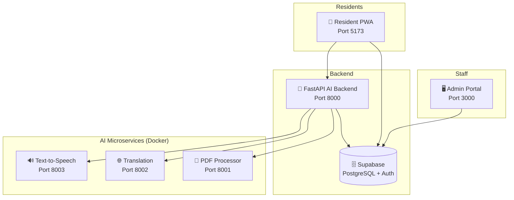
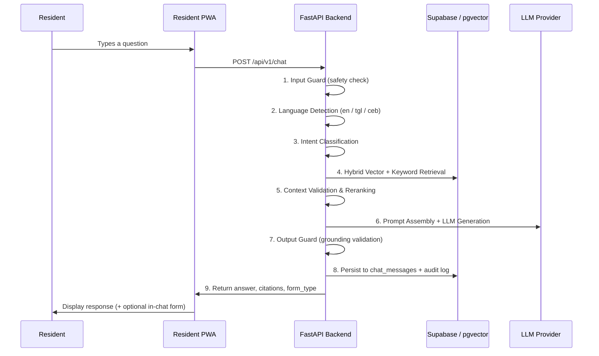

# 🏛️ Barangay AI — System Overview & Module Reference

> **System:** Smart Barangay — AI-Powered Barangay Management System
> **Barangay:** Tandang Sora, Butuan City
> **Version:** 1.0.0 · Last updated: November 2026

---

## Table of Contents

1. [System Purpose](#1-system-purpose)
2. [System Architecture](#2-system-architecture)
3. [Admin Portal Modules](#3-admin-portal-modules)
4. [Resident PWA](#4-resident-pwa)
5. [AI Model & RAG Pipeline](#5-ai-model--rag-pipeline)
6. [AI Microservices](#6-ai-microservices)
7. [Technology Stack](#7-technology-stack)
8. [Minimum System Requirements](#8-minimum-system-requirements)
9. [Role-Based Access Control](#9-role-based-access-control)
10. [Database Overview](#10-database-overview)
11. [Environment & Configuration](#11-environment--configuration)

---

## 1. System Purpose

**Barangay AI (Smart Barangay)** is a full-stack digital governance platform designed to modernize resident services at the barangay level. It replaces manual, paper-based workflows with an online, mobile-first system that is accessible even on low-bandwidth connections.

### Core Goals

| Goal | Description |
|------|-------------|
| 🗂️ Document Services | Residents can request barangay certificates, clearances, and other documents online with real-time status tracking. |
| 🤖 AI Assistant | An AI chatbot (backed by a RAG pipeline) answers resident queries using verified barangay policies, FAQs, and ordinances — in English, Filipino (Tagalog), or Cebuano. |
| 🏢 Administrative Workflows | Barangay staff manage resident records, document queues, complaints, businesses, announcements, and reporting through a structured admin dashboard. |
| 📱 Mobile-First Access | The Resident PWA is an installable Progressive Web App optimized for mobile phones on slow connections, with offline fallback support. |
| 🔒 Secure & Auditable | All staff actions are role-gated and audit-logged; AI responses are grounded in approved knowledge only. |

---

## 2. System Architecture



### Data Flow Summary

1. **Residents** interact with the PWA — submitting document requests, chatting with the AI, and viewing announcements. All data flows through Supabase (direct) or the FastAPI AI backend (for chat/AI features).
2. **Staff** use the Admin Portal to manage resident records, approve document requests, handle complaints, and publish announcements.
3. **FastAPI AI Backend** (`apps/api`) powers the RAG-based AI chat with a full LangChain orchestration pipeline — retrieval, grounding, multilingual support, memory, and audit logging.
4. **AI Microservices** (Dockerized) handle PDF extraction, language translation, and text-to-speech, bound locally and consumed by the FastAPI backend.

---

## 3. Admin Portal Modules

**Location:** `apps/admin-portal` · Port `3000`

The admin portal is a Next.js 14 (App Router) dashboard for barangay staff. Navigation and feature access are filtered by role.

---

### 🏠 Dashboard

**Route:** `/dashboard`

The entry point for logged-in staff. Provides a real-time snapshot of the barangay's service activity.

| Feature | Description |
|---------|-------------|
| KPI Cards | Total Document Requests, Pending Approvals, Registered Residents |
| Quick Stats | Live count queries pulled from Supabase with mock fallback |
| Activity Overview | Summary of recent requests, complaints, and announcements |

---

### 👥 Residents

**Route:** `/residents` and sub-routes

The core resident management module. Full CRUD with advanced filtering and categorization.

| Sub-Module | Route | Purpose |
|------------|-------|---------|
| Resident List | `/residents` | View, search, and manage all residents. Columns: Resident ID, Full Name, Purok, Verification Status, Actions. Supports search and filter by demographic flags. |
| Verification | `/residents/verification` | Review and approve or reject resident identity verification submissions (ID uploads, photos). |
| Household | `/residents/household` | Manage households — group residents by family unit and housing type. |
| Senior Citizens | `/residents/senior` | Filtered list of residents flagged as senior citizens (age 60+). |
| Persons with Disabilities | `/residents/pwd` | Filtered list of PWD-registered residents. |
| 4Ps Beneficiaries | `/residents/4ps` | Filtered list of residents enrolled in the 4Ps program (Pantawid Pamilyang Pilipino Program). |

**Resident Record Fields:**
Full name, birthdate, age, gender, civil status, contact number, email, voter status, senior flag, PWD flag, 4Ps flag, verification status, ID type, ID photo URL, purok, address.

---

### 📄 Documents

**Route:** `/documents` and sub-routes

Handles all document request workflows from submission to release.

| Sub-Module | Route | Purpose |
|------------|-------|---------|
| Requests | `/documents/requests` | Master queue of all submitted document requests. Staff can update status (Pending → Under Review → Approved → Released → Completed or Rejected). Writes an audit entry to `transactions` on each status change. |
| Certificates | `/documents/certificates` | Manage and generate barangay certificates (Clearance, Indigency, Residency, etc.). |
| Business Clearance | `/documents/business-clearance` | Specifically handles business clearance document requests. |
| Policies | `/documents/policies` | View and manage document policy templates used for generation. |

**Document Request Status Workflow:**
`Pending` → `Under Review` → `Approved` → `Released` → `Completed` (or `Rejected` at any stage)

---

### 🔍 Verification (Resident Identity)

**Route:** `/residents/verification`

Staff review resident-submitted identity documents (ID photos uploaded during PWA registration). They can approve or reject verification, changing the resident's `verification_status` from `Pending` to `Verified` or `Rejected`.

> This is distinct from document *request* approval — verification is about confirming who the resident is, not what they're requesting.

---

### 🏢 Organizations

**Route:** `/organizations`

Manage barangay-recognized organizations (e.g., homeowners associations, youth groups, senior citizen groups). Each organization can be linked to residents and programs.

| Feature | Description |
|---------|-------------|
| Organization List | View, add, edit, and archive organizations |
| Member Management | Link residents to organizations |
| Program Associations | Associate organizations with community programs |

---

### 📋 Programs

**Route:** `/programs`

Track and manage community programs run by or in partnership with the barangay (e.g., livelihood programs, health initiatives, 4Ps coordination).

| Feature | Description |
|---------|-------------|
| Program List | View all programs with status and description |
| Enrollment | Link residents to specific programs |
| Reporting | View program participation and beneficiary counts |

---

### 🏘️ Community

**Route:** `/community` and sub-routes

Manage the barangay's internal community structure and administrative geography.

| Sub-Module | Route | Purpose |
|------------|-------|---------|
| Officials | `/community/officials` | List and manage barangay officials (Kapitan, Kagawads, Secretary, Treasurer, etc.) with terms of service. |
| Purok | `/community/purok` | Define and manage puroks (sub-areas/zones within the barangay). Residents are assigned to puroks. |
| Precinct | `/community/precinct` | Manage electoral precincts. Used for voter information and election-related records. |

---

### ⚖️ Cases

**Route:** `/cases` — *Note: previously documented under a `cases` module; complaint handling is a core workflow.*

Handles barangay dispute resolution and incident tracking.

| Sub-Module | Purpose |
|------------|---------|
| Complaints | File, track, and resolve resident complaints. Categories: Peace & Order, Noise, Garbage, Safety, Infrastructure, Other. Status: Filed → Investigation → Hearing → Settlement → Closed. |
| Katarungang Pambarangay | Manage barangay-level mediation and conciliation proceedings (KP hearings, settlements). |
| Incident Reports | Log and track incidents within the barangay jurisdiction. |

---

### 💼 Business

**Route:** `/business` and sub-routes

Manage business registrations and permits within the barangay.

| Sub-Module | Route | Purpose |
|------------|-------|---------|
| Business Registry | `/business/registry` | Complete list of registered businesses. Statuses: Pending, Active, Inactive, Expired. |
| Permits | `/business/permits` | Manage annual barangay business permits. Statuses: Active, Expired, Revoked. |

---

### 📢 Communication

**Route:** `/communication` and sub-routes

All outgoing communications and engagement features.

| Sub-Module | Route | Purpose |
|------------|-------|---------|
| Announcements | `/communication/announcements` | Create, publish, and archive official barangay announcements. Statuses: Draft, Published, Archived. Visible to residents via PWA. |
| Appointments | `/communication/appointments` | Schedule and manage appointments between residents and barangay staff. |
| Notifications | `/communication/notifications` | View and manage system-generated resident notifications. |
| Transactions | `/communication/transactions` | Audit log of all document-related transactions and status changes. |
| Support Tickets | `/communication/support-tickets` | Handle resident support/inquiry tickets. |

---

### 🏠 Boarders

**Route:** `/boarders`

Track boarding house residents and transient individuals within the barangay jurisdiction. Distinct from permanent residents.

---

### 🧠 Knowledge Base

**Route:** `/knowledge`

Admin interface for managing the AI assistant's knowledge base. Staff can upload, review, and manage documents (policies, ordinances, FAQs) that the AI uses to answer resident queries.

| Feature | Description |
|---------|-------------|
| Document Upload | Add PDFs, text files, or documents to the knowledge base |
| Chunk Management | View how documents are split and stored for RAG retrieval |
| Ingestion Trigger | Trigger embedding and indexing of new documents |

---

### ⚙️ Administration

**Route:** `/administration` and sub-routes

System administration and configuration. Access restricted to Super Admin and Barangay Captain roles.

| Sub-Module | Route | Purpose |
|------------|-------|---------|
| Users | `/administration/users` | Manage staff accounts and assign roles |
| Roles | `/administration/roles` | View and configure role-based permission sets |
| Reports | `/administration/reports` | Generate and export operational reports |
| Settings | `/administration/settings` | System-wide configuration and preferences |
| Audit Log | `/administration/audit` | Full audit trail of system actions (fetches real data) |
| Policies | `/administration/policies` | Manage system-level operational policies |
| System Tests | `/administration/system-tests` | Run health checks and connectivity tests against AI services and database |

---

## 4. Resident PWA

**Location:** `apps/resident-pwa` · Port `5173`

A mobile-first Progressive Web App (PWA) that residents install on their smartphones. Optimized for `max-w-md` portrait screens and low-bandwidth connections.

### PWA Capabilities

| Capability | Detail |
|------------|--------|
| Installable | Installs to home screen via Web App Manifest; icons at 192×512px |
| Offline Fallback | Navigating offline shows `/~offline` page; build assets cached via Workbox |
| Push Notifications | Service worker handles Web Push for status updates (requires VAPID keys) |
| Shortcuts | Home screen shortcuts for "New Request" and "AI Chat" |
| Auth-aware Caching | Authenticated pages use `NetworkOnly` — never cached to protect resident privacy |

### PWA Routes

| Route | Purpose |
|-------|---------|
| `/home` | Landing screen: greeting, quick action buttons, latest announcement, latest document request status |
| `/requests` | List of the resident's document requests with status filter tabs (All, Pending, Approved, etc.) |
| `/requests/new` | Document request submission form — select document type, provide purpose and supporting info |
| `/announcements` | Browse official barangay announcements; filterable by category |
| `/chat` | AI assistant chat — accessible to both logged-in residents and guests |
| `/notifications` | In-app notification feed |
| `/profile` | View and edit profile information; sign out |
| `/support` | Contact support / submit a support ticket |
| `/onboarding` | First-time setup screens after registration |
| `/login` | Email/password login |
| `/register` | 4-step registration: Personal Info → Address → Account Credentials → ID Upload |
| `/pending-approval` | Shown after registration while awaiting staff verification |
| `/reset-password` | Password reset flow |

### Registration Flow (4 Steps)

```
Step 1: Personal Information
  → Full name, birthdate, gender, civil status, contact number

Step 2: Address
  → Street, purok, barangay details

Step 3: Account Credentials
  → Email, password, confirm password

Step 4: ID Upload
  → Upload a valid government-issued ID photo for identity verification
```

After registration, the resident lands on `/pending-approval` until a staff member verifies their identity in the admin portal.

---

## 5. AI Model & RAG Pipeline

The AI assistant in the resident PWA is powered by a **Retrieval-Augmented Generation (RAG)** pipeline running on the **FastAPI AI Backend** (`apps/api`).

### How It Works



### RAG Pipeline Stages

| Stage | Component | Description |
|-------|-----------|-------------|
| 1. Input Guard | `guard_service.check_input()` | Blocks harmful, off-topic, or policy-violating queries before any processing. |
| 2. Language Detection | `language_detector.detect_language()` | Detects whether the query is in English, Filipino (Tagalog), or Cebuano. |
| 3. Query Normalization | `QueryNormalizer` | Normalizes the query and classifies intent (e.g., `SERVICE_REQUIREMENTS`, `OFFICIAL_INFO`, `ANNOUNCEMENTS`, `GENERAL`, `AMBIGUOUS`). |
| 4. Model Routing | `model_router.route_query()` | Selects the appropriate LLM and capability tier based on query complexity and intent. |
| 5. Tool Execution | `tool_planner.plan_and_execute()` | For intent types that require live data (fees, locations, officials, policies), executes approved database tools. |
| 6. Hybrid Retrieval | `multilingual_retriever.retrieve()` | Performs hybrid vector similarity + keyword search across the `knowledge_chunks` table in Supabase/pgvector. Retrieves the top-5 most relevant document chunks. |
| 7. Context Validation | `ContextValidator.validate_and_rank()` | Validates retrieved chunks against trust level and relevance; reranks results. |
| 8. Knowledge Graph | `graph_store.query_relationships()` | For relational queries ("what does X require?"), traverses a knowledge graph of service relationships. |
| 9. Memory Retrieval | `memory_retriever.get_intelligent_context()` | Retrieves relevant past turns from the session's conversation memory. |
| 10. Prompt Assembly | `SYSTEM_PROMPT` | Assembles context, KG edges, tool results, conversation history, and language instruction into the final prompt. |
| 11. LLM Generation | `AIProviderManager.generate()` | Sends the prompt to the primary LLM. Runs up to 3 iterations (Bounded DAG) if grounding validation fails. |
| 12. Grounding Validation | `ResponseValidator.validate()` | Ensures the LLM's answer only cites sources from the retrieved chunk IDs. Never bypassed. |
| 13. Output Guard | `guard_service.check_output()` | Sanitizes the final answer; flags inappropriate content. |
| 14. Memory Save | `memory_service.add_turn()` | Persists the query–answer pair to session memory for future context. |
| 15. Audit Logging | `audit_service.log()` | Records every AI interaction: query, response, model used, latency, chunks retrieved, flagged status. |

### LLM Provider Failover

The system uses a **multi-provider failover chain** with circuit breakers:

| Priority | Provider | Model |
|----------|----------|-------|
| Primary | **Google Gemini** | `gemini-2.5-flash` |
| Fallback 1 | **Groq** | `llama-3.1-8b-instant` |
| Fallback 2 | **OpenRouter** | `meta-llama/llama-3.1-8b-instruct` |
| Fallback 3 | **Ollama** (optional) | `llama3.1` (local) |

- **Circuit Breaker:** After 3 consecutive failures, a provider is taken out of rotation for 30 seconds (cooldown).
- **Timeout:** Each LLM call has a 15-second timeout.
- **Failover is automatic** — the system retries with the next available provider transparently.

### Embedding Providers

| Priority | Provider | Notes |
|----------|----------|-------|
| Primary | **Google Gemini Embeddings** | Used for vector generation in production |
| Fallback | **Local (sentence-transformers)** | Optional; excluded from lightweight deployments due to memory limits |

### Language Support

The AI responds in the same language the resident uses:

| Language | Code | Notes |
|----------|------|-------|
| English | `en` | Full support |
| Filipino / Tagalog | `tgl` | Full support — default for new sessions |
| Cebuano | `ceb` | Full support — primary for Butuan City residents |

Language is detected automatically but can be overridden by the user.

### In-Chat Document Request Forms

When the AI detects that a resident wants to request a document (e.g., Barangay Clearance), it returns a `form_type: "document_request"` with a `form_schema` in the response. The PWA renders this as an **in-chat interactive form** (`InChatFormCard`), which:
1. Finds or creates the appropriate `document_types` row.
2. Inserts a `document_requests` row with `status: Pending`.
3. Notifies the resident that their request has been submitted.

### AI Safety & Grounding Rules

> The AI is **strictly bounded** — it never guesses or fabricates information.

| Rule | Enforcement |
|------|-------------|
| Only use retrieved context | Grounding validator rejects answers citing unlisted sources |
| Information hierarchy | Live DB data > Official DB > Verified docs > Approved web > KG > Memory |
| Input filtering | Harmful or off-topic queries are blocked before LLM call |
| Output filtering | Final answer is sanitized and flagged if inappropriate |
| Audit trail | Every AI interaction is logged with model, latency, and chunk IDs |
| No text logging in TTS | The TTS service never logs the text content it synthesizes |

---

## 6. AI Microservices

Three independent FastAPI services run in Docker and are consumed by the main AI backend.

### PDF Processor (Port 8001)

**Purpose:** Extract structured content from PDF documents for knowledge base ingestion.

| Item | Detail |
|------|--------|
| Engine | OpenDataLoader (Apache-2.0); requires Java 11+ |
| Input | PDF via URL (`file_url`) or multipart upload |
| Output Formats | Markdown, JSON, plain text, HTML |
| File Size Limit | 25 MB |
| Rate Limit | 20 requests/IP/minute |
| Endpoints | `POST /api/v1/documents/extract`, `POST /api/v1/documents/upload`, `GET /health` |

### Translation Service (Port 8002)

**Purpose:** Translate text between supported languages, primarily English ↔ Cebuano.

| Item | Detail |
|------|--------|
| Engine | CTranslate2 (OpenNMT) + SentencePiece + Lingvanex model files |
| Supported Languages | 11 languages; primary pair: `en ↔ ceb` |
| Max Text Length | 1,000 characters per request |
| Beam Size | 2 (quality/speed balance) |
| Compute | CPU (default); GPU opt-in; int8 quantization |
| Rate Limit | 60 requests/IP/minute |
| Endpoints | `GET /api/v1/languages`, `POST /api/v1/translate`, `GET /health` |

### Text-to-Speech / TTS (Port 8003)

**Purpose:** Convert text to natural-sounding speech audio for accessibility.

| Item | Detail |
|------|--------|
| Engine | F5-TTS (flow-matching diffusion transformer) |
| License Note | Code: MIT · **Pretrained weights: CC-BY-NC** (non-commercial use only) |
| Output | WAV audio file; accessible via URL for 24 hours |
| Max Text Length | 1,000 characters per request |
| Audio Cleanup | Generated files auto-deleted after `TTS_AUDIO_RETENTION_HOURS` (default: 24h) |
| Privacy | Input text is **never logged** |
| Rate Limit | 30 requests/IP/minute |
| Endpoints | `POST /api/v1/tts/generate`, `GET /api/v1/tts/audio/{file_id}`, `GET /health` |

> Additionally, the FastAPI AI backend exposes its own TTS route (`/api/v1/tts`) with configurable providers: **Gemini TTS** (`gemini-2.5-flash-preview-tts`, voice: `Kore`) or **OpenAI TTS** (`gpt-4o-mini-tts`, voice: `shimmer`).

---

## 7. Technology Stack

### Frontend (Both Apps)

| Concern | Technology |
|---------|------------|
| Framework | Next.js 14.2 (App Router), React 18, TypeScript 5 |
| Styling | Tailwind CSS 3, `clsx`, `tailwind-merge`, `tailwindcss-animate` |
| Data Fetching | `@supabase/ssr` + `@supabase/supabase-js`, TanStack Query |
| Forms | React Hook Form + Zod validation + `@hookform/resolvers` |
| Icons | `lucide-react` |
| Charts | `recharts` (admin portal) |
| Dates | `date-fns` |
| PWA | `@ducanh2912/next-pwa`, Workbox (resident PWA only) |

### Backend / Database

| Concern | Technology |
|---------|------------|
| Database | Supabase (PostgreSQL) with Row Level Security (RLS) |
| Auth | Supabase Auth (`auth.users`), cookie-based sessions |
| Vector Search | pgvector extension (for RAG chunk embeddings) |
| AI Backend | FastAPI + Python 3, Pydantic v2, Uvicorn |
| AI Framework | LangChain + LangChain Google GenAI, LangChain Groq, LangChain OpenAI |
| GraphQL API | Strawberry (FastAPI integration) |
| ORM / DB client | `supabase-py` |

### AI & ML

| Component | Technology |
|-----------|------------|
| Primary LLM | Google Gemini 2.5 Flash |
| Fallback LLMs | Groq (Llama 3.1), OpenRouter, Ollama (optional local) |
| Embeddings | Google Gemini Embeddings (primary), sentence-transformers (fallback) |
| RAG Framework | LangChain |
| PDF Extraction | OpenDataLoader (Java-based) |
| Translation | CTranslate2 + SentencePiece + Lingvanex |
| TTS | F5-TTS / Gemini TTS / OpenAI TTS |

### Infrastructure

| Concern | Technology |
|---------|------------|
| Containerization | Docker + Docker Compose |
| Package Management | npm workspaces (Node.js), pip + venv (Python) |
| CI/CD | GitHub Actions |
| Deployment Target | Vercel (frontends), Render / Docker host (AI backend) |

---

## 8. Minimum System Requirements

### For Residents (Using the PWA)

| Requirement | Minimum |
|-------------|---------|
| Device | Any smartphone or tablet (Android 8+ / iOS 14+) |
| Browser | Chrome 90+ / Safari 14+ / Firefox 90+ / Edge 90+ |
| Internet | 3G or better (the PWA is optimized for low bandwidth) |
| Storage | ~5 MB for PWA installation |
| Screen | Portrait orientation recommended; `max-w-md` layout (≤ 428px wide) |
| JavaScript | Must be enabled |

### For Barangay Staff (Using the Admin Portal)

| Requirement | Minimum |
|-------------|---------|
| Device | Desktop or laptop computer |
| Browser | Chrome 90+ / Edge 90+ / Firefox 90+ (desktop) |
| Screen Resolution | 1280 × 720 minimum; 1920 × 1080 recommended |
| Internet | Stable broadband (5 Mbps+) |
| JavaScript | Must be enabled |

### For Development (Local Setup)

| Requirement | Minimum | Recommended |
|-------------|---------|-------------|
| Node.js | v20 LTS | v22 LTS |
| npm | v10 | latest |
| Python | 3.11 | 3.13 |
| RAM | 8 GB | 16 GB |
| Disk Space | 10 GB free | 20 GB free |
| OS | Windows 10 / macOS 12 / Ubuntu 22.04 | Windows 11 / macOS 14 / Ubuntu 24.04 |
| Docker | 24.0+ (for AI microservices) | Latest |
| Java | 11+ (for PDF processor outside Docker) | OpenJDK 17 |

### For Production Deployment (AI Backend on Server)

| Requirement | Minimum | Notes |
|-------------|---------|-------|
| RAM | 2 GB | 512 MB is insufficient if using sentence-transformers; use Gemini embeddings instead |
| CPU | 2 vCPU | 4 vCPU recommended for TTS inference |
| Disk | 10 GB | Models add ~1–3 GB per AI service |
| GPU | Optional | CUDA-compatible GPU speeds up TTS and translation significantly |
| OS | Ubuntu 22.04 LTS | Docker-capable Linux preferred |
| Python | 3.11+ | |
| Network | Outbound HTTPS | For Gemini, Groq, OpenRouter API calls |

---

## 9. Role-Based Access Control

The admin portal uses a full RBAC system. Roles are stored in the `roles` table; permissions per role and module in the `permissions` table.

### Roles

| Role | Description |
|------|-------------|
| **Super Admin** | Unrestricted access to all modules and system settings. Can manage users and roles. |
| **Barangay Captain** | Full operational access; oversight of all modules; can approve high-level actions. |
| **Secretary** | Access to residents, documents, communication, and community modules. |
| **Treasurer** | Access to business permits, transactions, and financial reporting. |
| **Staff** | Access to residents, document requests, and communication. Limited edit/delete rights. |

### Permission Flags (per Role × Module)

| Flag | Meaning |
|------|---------|
| `can_view` | Can see the module and its data |
| `can_create` | Can add new records |
| `can_edit` | Can modify existing records |
| `can_delete` | Can remove records |
| `can_approve` | Can approve/reject workflow items (e.g., document requests, verifications) |

**Super Admin** automatically receives all `true` for every module without a database lookup.

---

## 10. Database Overview

**Platform:** Supabase PostgreSQL

### Key Tables by Module

| Module | Tables |
|--------|--------|
| Auth & Roles | `roles`, `permissions`, `users` |
| Residents | `residents`, `households`, `household_members`, `addresses` |
| Documents | `document_types`, `document_requests`, `documents` |
| Community | `officials`, `puroks`, `precincts` |
| Cases | `complaints`, `hearings`, `settlements` |
| Business | `businesses`, `business_permits` |
| Communication | `announcements`, `appointments`, `notifications`, `transactions`, `audit_logs` |
| AI / Chat | `chat_messages`, `knowledge_chunks`, `ai_sessions` |
| Programs | `programs`, `program_enrollments` |
| Organizations | `organizations`, `organization_members` |

### Row Level Security (RLS)

RLS is enabled on `chat_messages` — residents can only read and write their own messages. All other tables are protected at the application layer (server actions enforce auth; admin portal requires login via middleware).

> **Production note:** RLS should be extended to residents, documents, and complaints tables before full public deployment.

---

## 11. Environment & Configuration

### Required Environment Variables

**Root `.env`** (AI microservices via Docker Compose):

| Variable | Purpose |
|----------|---------|
| `AI_PDF_SERVICE_URL` | PDF processor URL (default: `http://localhost:8001`) |
| `AI_TRANSLATION_SERVICE_URL` | Translation service URL (default: `http://localhost:8002`) |
| `AI_TTS_SERVICE_URL` | TTS service URL (default: `http://localhost:8003`) |

**`apps/api/.env`** (FastAPI AI backend):

| Variable | Purpose |
|----------|---------|
| `SUPABASE_URL` | Supabase project URL (service key access) |
| `SUPABASE_SERVICE_KEY` | Supabase service-role key (server-side only) |
| `GEMINI_API_KEY` | Google Gemini API key (primary LLM + embeddings + TTS) |
| `GEMINI_MODEL` | Gemini model name (default: `gemini-2.5-flash`) |
| `GROQ_API_KEY` | Groq API key (fallback LLM) |
| `OPENROUTER_API_KEY` | OpenRouter API key (fallback LLM) |
| `OLLAMA_ENABLED` | `true` to enable local Ollama as final fallback |
| `AI_PROVIDER_PRIMARY` | Primary provider (default: `gemini`) |
| `AI_PROVIDER_TIMEOUT_MS` | LLM call timeout in milliseconds (default: `15000`) |
| `AI_CIRCUIT_FAILURE_THRESHOLD` | Failures before circuit opens (default: `3`) |
| `AI_CIRCUIT_COOLDOWN_SECONDS` | Cooldown before retrying failed provider (default: `30`) |
| `TTS_PROVIDER` | TTS provider: `gemini` or `openai` |
| `CORS_ALLOWED_ORIGINS` | Comma-separated list of allowed frontend origins |

**Per-App `.env.local`** (admin portal and resident PWA):

| Variable | Purpose |
|----------|---------|
| `NEXT_PUBLIC_SUPABASE_URL` | Supabase project URL |
| `NEXT_PUBLIC_SUPABASE_ANON_KEY` | Supabase public anon key |
| `NEXT_PUBLIC_MOCK_SUPABASE` | Set to `true` to run fully offline with mock data |
| `NEXT_PUBLIC_AI_SERVICES_ENABLED` | Set to `true` to enable AI service calls from the PWA |

### Quick Start Commands

```bash
# Install all dependencies
npm install

# Start Admin Portal (port 3000)
npm run dev:admin

# Start Resident PWA (port 5173)
npm run dev:pwa

# Start FastAPI AI Backend (port 8000)
cd apps/api && uvicorn main:app --reload --host 0.0.0.0 --port 8000

# Start all AI microservices via Docker
npm run ai:up

# Run AI microservice tests
npm run ai:test

# Build all frontends
npm run build:all
```

---

*This document is auto-generated from the actual codebase. For the full engineering documentation hub, see the `docs/` directory and [`PROJECT.md`](./PROJECT.md).*

